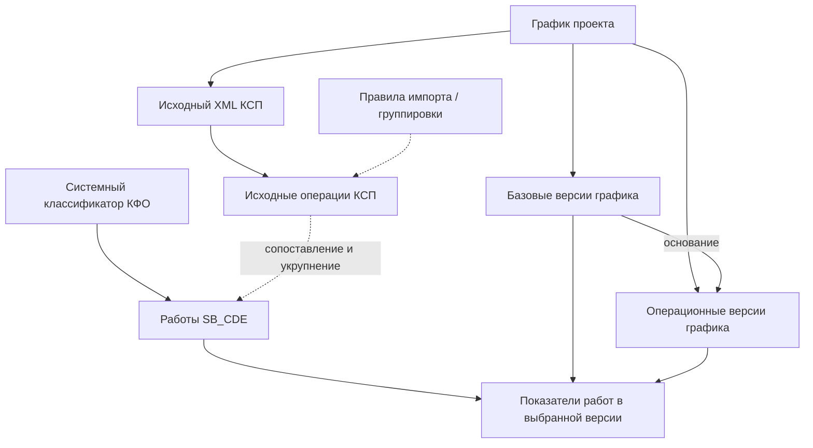

# SB_CDE — Графики проекта: итог обсуждения

**Назначение.** Единый рабочий документ по результатам обсуждения сущности «Работа», графиков проекта, импорта КСП и изменения данных во времени. Документ предназначен для последующего проектирования функциональности SB_CDE, **не является** готовым ТЗ, моделью БД, макетом интерфейса или описанием существующей реализации.

**Как читать статусы:**

- **[РЕШЕНО]** — прямо уточнено или подтверждено пользователем в текущем обсуждении.
- **[ПРОВЕРЕНО В XML]** — непосредственно установлено при разборе предоставленного `down_PL_CON_13.xml`; не означает, что это уже реализовано в SB_CDE.
- **[ПРЕДЛОЖЕНИЕ]** — предложенная концепция/правило, требующее согласования.
- **[ОТКРЫТО]** — недостаточно информации или остаётся выбор.
- **[ОГРАНИЧЕНИЕ]** — явно исключаем из текущего объёма задач.

> **Принцип:** не объявлять допущения о правилах импорта, агрегации, согласовании и данных XML утверждёнными требованиями. Не путать исходные операции КСП, системные работы и BIM-элементы.

---

## 1. Цель и границы рассматриваемой функциональности

**[РЕШЕНО]** Сосредотачиваемся на периоде **СМР**. Эволюция состава работ от концепции к ПД и РД существует в строительном процессе, но **не моделируется подробно** на текущем этапе.

- На СМР сведения о работах могут присутствовать в **КСП** и **BoQ** (ведомость объёмов работ).
- **[РЕШЕНО]** В рамках текущего сценария **КСП принимается единым источником актуальных показателей работ** с ориентиром на еженедельное обновление; интеграция BoQ пока не рассматривается.
- **[РЕШЕНО]** Работа SB_CDE агрегируется на уровне **КФО + корпус + секция + этаж**. Не создаём отдельную работу на каждый BIM-элемент.
- **[РЕШЕНО]** Если группа BIM-элементов связывается с одной работой, отображаемые показатели этой работы распространяются на всю соответствующую группу. Поэлементный ход выполнения не моделируем.
- **[ОГРАНИЧЕНИЕ]** Алгоритмы привязки элементов BIM-модели, 3D-отображение и детальный 4D/5D-таймлайнер — не предмет текущего этапа.
- **[ОГРАНИЧЕНИЕ]** Стоимость и финансовые источники встречаются в исходных данных, но правила их обработки в данном обсуждении не согласованы. Основной предмет — состав работ, сроки, объёмы и статусы.

**Важное уточнение к фразе «КСП — единый источник»:** это принятое **ограничение текущего сценария**, а не доказательство, что иных источников фактического выполнения или стоимости на проекте не бывает.

## 2. Словарь сущностей и различия между ними

| Сущность / понятие | Рабочее определение | Статус |
|---|---|---|
| **КФО** | Запись системного классификатора видов/групп работ, имеющая собственный код. | [РЕШЕНО] |
| **Исходная операция КСП** | Запись импортируемого графика, в т. ч. конечная операция с WBS, идентификаторами, датами, объёмом и атрибутами. | [ПРОВЕРЕНО В XML] |
| **Работа SB_CDE** | Укрупнённая единица учёта на проекте: позиция КФО в определённой пространственной детализации. Несколько исходных операций КСП могут относиться к одной работе SB_CDE. | [РЕШЕНО для укрупнения; ПРЕДЛОЖЕНИЕ для агрегации] |
| **Справочник / реестр «Работы»** | Набор работ проекта, который предполагается формировать исходя из данных импортированного КСП и системного КФО. | [РЕШЕНО: отталкиваться от импорта; ОТКРЫТО: окончательная модель справочника] |
| **График проекта** | Логический объект в SB_CDE, через который пользователь работает с составом работ, импортом и версиями КСП. | [ПРЕДЛОЖЕНИЕ], рабочее название модуля |
| **Базовый график** | Утверждаемый график, на основании которого создаётся операционный. Может пересматриваться при критических изменениях. | [РЕШЕНО] |
| **Операционный график** | Актуализируемый без согласования график на основании определённой версии базового. | [РЕШЕНО] |
| **Версия графика / снимок данных** | Конкретное зафиксированное состояние базового или операционного графика. | [РЕШЕНО: нужна история версий; ПРЕДЛОЖЕНИЕ: техническая сущность «снимок»] |
| **Показатели работы в версии** | Значения сроков, объёмов и других показателей для работы в определённой версии графика. | [ПРЕДЛОЖЕНИЕ], способ хранения не выбран |
| **Правило импорта / интерпретации** | Способ определить поля, атрибуты, иерархию и соответствия справочникам при загрузке файла КСП. | [ПРЕДЛОЖЕНИЕ], конкретные правила не утверждены |

**Не одно и то же:**

```text
Код КФО / запись классификатора ≠ операция в XML ≠ работа SB_CDE
Работа SB_CDE ≠ её показатели в версии КСП
График проекта ≠ один загруженный файл ≠ база данных
WBS исходной операции ≠ уникальный ключ работы SB_CDE
```

**[РЕШЕНО]** Одна укрупнённая работа может соответствовать нескольким технологическим операциям КСП, если они относятся к одной позиции КФО и одной применимой пространственной детализации.

## 3. Что является «одной работой»

### 3.1. Целевое определение

**[РЕШЕНО]** Целевая идентичность работы для данного этапа:

```text
КФО + корпус + секция + этаж
```

Ниже уровня этажа и отдельных BIM-элементов детализация не предусматривается. Стены, колонны и прочие исходные операции не создают автоматически отдельные работы, если уже совпадают по принятому ключу.

### 3.2. Обнаруженное противоречие: целевой ключ и неполные атрибуты источника

**[РЕШЕНО]** Пользователь отдельно уточнил, что в самом КСП **не обязательно будут присутствовать отдельные поля** «Корпус», «Секция» и «Этаж»; атрибуты могут находиться в разных местах либо некоторые характеристики могут отсутствовать даже в рамках одного графика.

**[ОТКРЫТО]** Пока нельзя автоматически объявить, что отсутствие поля эквивалентно отсутствию пространственной детализации у самой работы. Нужно различить как минимум:

1. Характеристика **применима и известна** (например, «Этаж 1»).
2. Характеристика **не применяется** к данному виду работы (например, для работ без этажной привязки).
3. Характеристика **применима, но в файле не найдена / не распознана**.
4. Характеристика в источнике **объединяет несколько значений** (например, «Корпус А, Б, В»).

**[ОТКРЫТО]** Правило формирования устойчивого ключа, если не все четыре компонента определены, пока **не принято**. Не подставлять молча пустую строку, «все», `null` или фиктивную секцию и не считать такие варианты эквивалентными.

### 3.3. Стабильность работы между версиями

**[РЕШЕНО]** При еженедельном обновлении операционного КСП работа не должна появляться как новая системная работа, если меняются только её показатели. Показатели запрашиваются на выбранную версию, по умолчанию — актуальную.

**[ПРЕДЛОЖЕНИЕ]** Логически разделить постоянную **работу** и её **данные в версии графика**. Это не требование заводить две таблицы: речь о границе понятий.

## 4. Базовый и операционный графики: правила жизненного цикла

### 4.1. Утверждённый процесс

1. **[РЕШЕНО]** Базовый график готовится генподрядчиком совместно с представителями заказчика/технического заказчика и **согласовывается**; конкретные роли утверждения не зафиксированы.
2. **[РЕШЕНО]** Операционный график **строится на основе базового** и актуализируется, как правило, еженедельно, силами генподрядчика по данным фактического хода строительства.
3. **[РЕШЕНО]** Каждое операционное обновление **не проходит повторного согласования**.
4. **[РЕШЕНО]** При **критических изменениях** пересматривается базовый график, который вновь направляется на согласование. Последующие операционные графики формируются на основе **новой утверждённой базовой версии**.
5. **[ОТКРЫТО]** Перечень и критерии критических изменений ожидают отдельного регламента; из самого XML их определить нельзя.

### 4.2. Ограничения на изменение состава

| Изменение | Операционный график в рамках существующего базиса | Переработанный базовый график |
|---|---|---|
| Изменение сроков | **Допускается** [РЕШЕНО] | Допускается в рамках процедуры пересмотра [РЕШЕНО в общем смысле] |
| Изменение объёмов | **Допускается** [РЕШЕНО] | Допускается в рамках процедуры пересмотра [РЕШЕНО в общем смысле] |
| Новые / удалённые работы | **Не допускаются** [РЕШЕНО] | Запрет на новые/удалённые работы **не распространяется автоматически**; конкретный регламент [ОТКРЫТО] |
| Разделение / объединение работ | **Не допускается** [РЕШЕНО] | [ОТКРЫТО] |
| Изменение КФО, этажа | **Не допускается** [РЕШЕНО] | [ОТКРЫТО] |
| Изменение корпуса / секции | [ОТКРЫТО]; поскольку входит в ключ работы, потенциально означает смену идентичности | [ОТКРЫТО] |
| Изменение статуса или факта выполнения | Факт обновления допускается в рамках актуализации; правила вычисления статуса [ОТКРЫТО] | [ОТКРЫТО] |

**Логический вывод [ПРЕДЛОЖЕНИЕ]:** для операционной версии сравнивать **множество идентифицированных работ** с составом исходного базиса и отдельно проверять изменения запрещённых атрибутов. Некорректно сравнивать только число строк исходного XML: несколько операций могут быть одной системной работой.

### 4.3. Версионность и происхождение базиса

**[РЕШЕНО]** Пользователь должен понимать:

- какая версия графика — **базовая**;
- на основе **какой базовой версии** сформирована конкретная операционная версия;
- какие показатели относятся к **текущей** и **выбранной исторической** версии.

**[ПРЕДЛОЖЕНИЕ]** Пример цепочки (обозначения условные):

```text
Базовый Б-1 (утверждён)
  ├─ Операционный О-1 → основание Б-1
  ├─ Операционный О-2 → основание Б-1
  └─ Операционный О-3 → основание Б-1

Критическое изменение → согласование нового базиса

Базовый Б-2 (утверждён)
  ├─ Операционный О-4 → основание Б-2
  └─ Операционный О-5 → основание Б-2
```

**[ПРЕДЛОЖЕНИЕ]** Сохранять старые базовые версии и связь операционных версий с их базисом; не перепривязывать исторические операционные версии к новому базису задним числом.

**[ОТКРЫТО]** Способ нумерации, утверждение первого графика, ветвление историй, статус чернового нового базиса, критерии «актуальной» версии и дата её действия ещё не определены.

## 5. Показатели работы и их идентификаторы

### 5.1. Какие показатели обсуждались

**[РЕШЕНО]** Сроки, объёмы и статусы рассматриваются применительно к базовому и операционному графику; ранее пользователь называл **плановые, прогнозные, фактические** группы данных.

**[ОТКРЫТО]** Конкретные определения «план», «операционный план», «прогноз», «факт» и их отношение к двум типам графиков **ещё не согласованы**. Нельзя автоматически приравнивать `Start`/`Finish` из XML к утверждённым базовым срокам, а `EarlyStart`/`LateStart` — к бизнес-прогнозам.

**[ПРЕДЛОЖЕНИЕ]** Различать:

- **вид показателя:** начало, окончание, объём, процент, статус и т. п.;
- **смысл значения:** базис/текущая версия/факт/прогноз — после утверждения словаря;
- **период/версию, к которой значение относится**;
- **исходную операцию**, из которой значение прочитано;
- **укрупнённую работу**, для которой значение рассчитано.

### 5.2. Что действительно есть в XML

**[ПРОВЕРЕНО В XML]** Прямо в записях `<Task>` присутствуют следующие имена полей (заполненность различается):

| Поле XML | Смысл / оговорка |
|---|---|
| `Start`, `Finish` | Даты начала и окончания операции в экспорте; тип базис/прогноз не установлен |
| `ActualStart`, `ActualFinish` | Поля фактического начала и окончания |
| `EarlyStart`, `EarlyFinish` | Расчётные ранние сроки; **не** автоматически бизнес-прогноз |
| `LateStart`, `LateFinish` | Расчётные поздние сроки; **не** автоматически бизнес-прогноз |
| `PercentComplete` | Процент выполнения, если поле есть у операции |
| `SP_VolPlan` | Поле планового объёма |
| `SP_VolFact` | Поле фактического объёма; присутствует не у всех задач |
| `SP_PlanCost`, `ActualCost` | Поля стоимости; правила 5D в этом документе не определены |

**[ПРОВЕРЕНО В XML]** У **самих значений** `Start`, `SP_VolPlan` и т. п. **нет отдельного универсального уникального ID** в рассмотренной структуре: это именованные поля записи операции. Для указания происхождения значения можно использовать сочетание идентификатора исходной операции, версии источника и имени поля — **[ПРЕДЛОЖЕНИЕ]**, не существующая схема SB_CDE.

Отдельно: `FieldID = 188744009` в описании настраиваемых полей относится к атрибуту **«Код КФО»**, а не служит идентификатором значения или работы.

### 5.3. Агрегирование нескольких операций в одну работу

**[ПРОВЕРЕНО В XML]** Несколько операций могут иметь **одинаковый КФО и один пространственный контекст**. Следовательно, укрупнённая работа не обязана соответствовать одной строке `<Task>`.

**[ПРЕДЛОЖЕНИЕ]** Примеры возможных правил, **не согласованные как требования**:

| Показатель итоговой работы | Кандидат на правило | Критическое условие |
|---|---|---|
| Начало | Минимум дат начала включённых операций | Сравниваются даты с одинаковым бизнес-смыслом |
| Окончание | Максимум дат окончания включённых операций | То же |
| Плановый / фактический объём | Сумма соответствующих объёмов | **Совместимость единиц, отсутствие дублей и корректная интерпретация объёмов** |
| Процент выполнения | Отдельный расчёт или правило приоритета | Простое среднее процентов может быть некорректным |
| Статус | Отдельная статусная логика | **Не** следует автоматически из даты окончания |

**[ОТКРЫТО]** Из XML нельзя подтвердить универсальный способ сворачивания плановых, фактических и прогнозных сроков и объёмов. В частности, суммирование `SP_VolPlan` для разных операций без проверки единиц измерения и их смысла нельзя считать валидным результатом.

## 6. Первичный импорт КСП и получение справочника «Работы»

### 6.1. Принятое направление

**[РЕШЕНО]** Для первоначального проектирования отталкиваемся от **импорта исходного графика**, а не от обязательного предварительного ручного создания каждой работы.

**[РЕШЕНО]** Главные задачи — **сопоставить КФО графика и системный справочник КФО**, затем понять, по каким характеристикам сформировать/свернуть работы в нужную детализацию.

**[ПРЕДЛОЖЕНИЕ]** Последовательность обработки:

1. Загрузить исходный XML КСП в контексте текущего проекта.
2. Прочитать **все исходные операции и иерархические узлы**, не потеряв структуру WBS и исходные ID.
3. Отобрать ветку **СМР** по настройке/правилу; в **данном примере** она соответствует WBS `5`, но этот код **нельзя навязывать всем импортам**.
4. Найти `Код КФО` и сопоставить с системным классификатором.
5. Определить доступные пространственные характеристики из атрибутов самой операции и/или структуры предков WBS.
6. Обозначить отсутствующие, неоднозначные и неприменимые характеристики отдельно.
7. Сформировать кандидатов в укрупнённые работы SB_CDE; сгруппировать операции по согласованным признакам.
8. Рассчитать показатели **только** по утверждённым правилам агрегирования.
9. Показать пользователю результат, ошибки и неоднозначности; зафиксировать базовую редакцию по согласованной процедуре.

**[ОТКРЫТО]** Что считается обязательным результатом импорта, как пользователь исправляет неполные поля, является ли импорт транзакционным и какие ошибки блокируют принятие данных.

### 6.2. Три разных вида результата разбора

**[ПРЕДЛОЖЕНИЕ]** На выходе полезно различать:

- **Исходные операции КСП** — все нужные записи файла без потери `WBS`, `Spider_Code`, исходных сроков/объёмов.
- **Кандидаты в работы** — сгруппированные операции с интерпретированными КФО и пространством.
- **Проблемы сопоставления** — нераспознанный КФО, неустановленная локация, несколько корпусов/этажей, конфликт количества, дублирование и др.

Это три **логических** вида данных, не утверждённые экраны или таблицы БД.

### 6.3. Представления графика и режимы работы

**[ПРЕДЛОЖЕНИЕ]** Для модуля «Графики проекта» отдельно рассмотреть:

- **Режим**: `Просмотр` / `Редактирование` (включая первичную загрузку и настройку разбора).
- **Представление**: `Таблица` / `Дерево` — независимо от режима.
- **Уровень представления**: `Исходные операции КСП` / `Укрупнённые работы SB_CDE` — варианты, требующие UX-проработки.

**[ОТКРЫТО]** Что именно разрешено редактировать руками, какие действия доступны при загрузке новой базы, и нужен ли особый мастер импорта. Нельзя считать ранее набросанный путь утверждённым UX.

**[РЕШЕНО как пользовательский замысел]** Предполагаемый модуль называется **«Графики проекта»** (название рабочее), с командами вроде «Создать график», «Обновить данные», «Загрузить новый базовый»; точные подписи и последовательность ещё не определены.

**[ОТКРЫТО]** Где хранить настройки импорта: внутри графика или как переиспользуемые шаблоны. Пользователь пока **не готов выбирать**.

## 7. Что установлено непосредственным анализом `down_PL_CON_13.xml`

### 7.1. Структура файла

**[ПРОВЕРЕНО В XML]** Это XML с пространством имён `http://schemas.microsoft.com/project`, с корнем `<Project>` и иерархией `<Tasks><Task>...`.

- Всего записей `<Task>`: **3 134**.
- Ветка СМР (`WBS = 5` и потомки): **2 030** записей, из них **1 527** конечных операций (`Summary = 0`) и **503** сводных узла (`Summary = 1`).
- У **284** конечных операций СМР заполнено настраиваемое поле **«Код КФО»**; найдено **28** уникальных кодов КФО. Следовательно, **1 243** конечные операции этой ветки не содержат явно заполненного «Код КФО».
- Эти цифры описывают **конкретный пример**, а не качество всех будущих КСП и не число работ SB_CDE.

**[ПРОВЕРЕНО В XML]** Верхние разделы СМР: подготовительный период и ВЗиС (`5.1`), Shell&Core (`5.2`), Fit-out служебных/технических помещений (`5.3`), наружные сети (`5.4`), благоустройство (`5.5`), Fit-out дизайнерских помещений (`5.6`).

### 7.2. Идентификаторы и классификация исходной операции

**[ПРОВЕРЕНО В XML]** Для операций предусмотрены:

| Поле | Что показывает |
|---|---|
| `UID`, `ID` | Идентификаторы в выгрузке; стабильность между экспортами **не подтверждена** |
| `Spider_Code` | Пользовательский код операции (алиас настраиваемого `FieldID = 188744016`); стабильность между версиями **не подтверждена** |
| `WBS`, `OutlineLevel`, `Summary` | Положение в дереве / уровень / признак сводной строки |
| `Name` | Название операции |
| `Код проекта`, `Проект`, `Код объекта`, `Объект`, `Код подобъекта`, `Подобъект` | Пользовательские атрибуты проекта/объекта |
| `Код CBS`, `CBS` | Отдельные поля классификации CBS |
| `Код КФО`, `КФО` | Отдельные поля классификации КФО |

**[ПРОВЕРЕНО В XML]** Отдельный атрибут **«Код SBS»** среди объявленных настраиваемых полей данного файла **не обнаружен**. **CBS ≠ автоматически SBS**. Наличие `Код объекта` также не означает наличие отдельного поля «Корпус» или «Секция».

### 7.3. Реальные операции `11318857`, `11318859`, `11318861`

`Spider_Code` — это значение специального пользовательского поля XML, не код КФО.

| Атрибут | `11318857` | `11318859` | `11318861` |
|---|---|---|---|
| `UID` | `1746` | `1749` | `1752` |
| `WBS` | `5.2.2.1.2.1.1.2` | `5.2.2.1.2.1.2.2` | `5.2.2.1.2.1.3.2` |
| `Name` | Бетонирование | Бетонирование | Бетонирование |
| Родительская группа | Стены | Колонны | Плиты перекрытия |
| Общий пространственный контекст в WBS | 1 этаж, корпус А | 1 этаж, корпус А | 1 этаж, корпус А |
| `Код КФО` | `204.02.03.01` | `204.02.03.01` | `204.02.03.02` |
| `SP_VolPlan` | `210` | `84` | `986` |
| `Start` | `2026-08-02` | `2026-08-02` | `2026-07-31` |
| `Finish` | `2026-08-06` | `2026-08-06` | `2026-07-31` |

**Вывод [ПРОВЕРЕНО В XML]:** `11318857` и `11318859` — разные технологические операции с **одинаковым КФО**, а `11318861` имеет **другой КФО**. При совпадающих применимых пространственных характеристиках первые две **могут** стать одной укрупнённой работой SB_CDE. Третья — другая работа.

**Иллюстрация [ПРЕДЛОЖЕНИЕ]:** `210 + 84 = 294` — *только арифметический пример*. Без подтверждения совместимости единиц измерения и семантики объёмов нельзя объявлять `294` нормативным показателем работы SB_CDE.

### 7.4. Корпус и этаж обнаруживаются через дерево WBS

**[ПРОВЕРЕНО В XML]** Для `11318859` цепочка предков такова:

```text
5                 СМР
5.2               Работы раздела Shell&Core
5.2.2             Устройство каркасов
5.2.2.1           ЖБ конструкции
5.2.2.1.2         1 этаж на отм. -0.200
5.2.2.1.2.1       Корпус А
5.2.2.1.2.1.2     Колонны
5.2.2.1.2.1.2.2   Бетонирование
```

Следовательно, **WBS позволяет найти родительские узлы**, из названий которых *в этом примере* можно интерпретировать этаж и корпус. **Сам код WBS не является кодом корпуса или этажа**.

**[ПРОВЕРЕНО В XML]** Встречаются объединённые формулировки, например **«Корпус А, Б, В»**, и операции, относящиеся к нескольким корпусам. Значение «Корпус А, Б, В» нельзя автоматически распределять по трём корпусам с дублированием объёма.

**[ПРОВЕРЕНО В XML]** Явная секция как отдельное именованное поле или название узла **в проверенной ветке СМР не выявлена**. Это не доказательство того, что ни одной секции нет в иных исходных проектах или в неструктурированном тексте атрибутов.

**[ОТКРЫТО]** Правила обработки отсутствующих/объединённых корпуса, секции и этажа должны определяться отдельно. Возможное решение — улучшить исходную классификацию/атрибуты КСП и КФО; пользователь планирует заняться этим позже.

### 7.5. Ограничения интерпретации примера

- **[ПРОВЕРЕНО В XML]** Есть метаданные `Revision = 13`, `StatusDate = 2026-07-27`, `LastSaved = 2026-09-25`.
- **[ОТКРЫТО]** Эти поля **не доказывают**, что файл является утверждённым базовым или операционным графиком, и не определяют статус согласования.
- **[ПРОВЕРЕНО В XML]** В части СМР много конечных операций без КФО; причина этого **не установлена**. Нельзя автоматически приписывать им КФО по родителям без утверждённого правила.
- **[ОТКРЫТО]** В первоначальном примере был обнаружен один КФО, назначенный разным по названию операциям. Пользователь допускает ошибку исходной классификации; без проверки нормативного содержания КФО это **не считать доказанной ошибкой**, но фиксировать как кандидат на проверку данных.

## 8. Концептуальная карта связей

**[ПРЕДЛОЖЕНИЕ]** Ниже — карта **понятий**, а не ER-диаграмма, описание конкретных таблиц или утверждённые ограничения хранения.



Смысл: XML хранит операции; импорт их распознаёт; одни или несколько операций могут быть сопоставлены одной системной работе; график имеет версии; запрос показателей выбирает нужную версию и соответствующий базис.

## 9. Пользовательский процесс: что есть и что ещё не решено

### 9.1. Начальное создание графика

**[Замысел пользователя, не утверждённый UX]** Пользователь находится **внутри проекта SB_CDE**, открывает «Графики проекта», нажимает «Создать график» и загружает исходный КСП (например XML); вариант ручного создания первоначального базового графика обсуждался, но **не выбран**.

**[ПРЕДЛОЖЕНИЕ]** После импорта виден результат разбора — список операций, дерево источника, кандидаты в укрупнённые работы и ошибки классификации/агрегации.

### 9.2. Работа с существующим графиком

**[Замысел пользователя, не утверждённый UX]** Пользователь открывает уже созданный график; возможны команды «Обновить данные» (операционная версия) и «Загрузить новый базовый» (пересмотр базиса).

**[ПРЕДЛОЖЕНИЕ]** Основной просмотр показывает актуальную операционную версию, переключатель позволяет выбрать историческую. При выборе версии видно, какой базис к ней относится.

### 9.3. Режимы и формы отображения

**[ОТКРЫТО]** Делить ли управление на два режима «Редактирование» / «Просмотр». **[ПРЕДЛОЖЕНИЕ]** Не путать режим действий с формой отображения «Дерево» / «Таблица»; это независимые измерения интерфейса.

**[ОТКРЫТО]** Когда и кому разрешено редактирование, как оформляется переход от загруженного файла к подтверждённой версии, разрешены ли ручные исправления данных, каково место согласования базового графика.

## 10. Разрешённые противоречия предыдущего обсуждения

1. **«Операционный график не меняет состав работ» против «новая базовая версия может менять состав».** Исправленная трактовка: запрет относится **только к операционным версиям внутри текущего базиса**. Для нового базиса правила изменения состава ещё не согласованы.
2. **«Работа — одна строка КСП» против «работа — КФО + корпус + секция + этаж».** Исправленная трактовка: одна системная работа **может объединять несколько исходных операций КСП**; исходные строки сохраняют собственные идентификаторы и показатели.
3. **«Есть четыре обязательные характеристики работы» против «не все характеристики присутствуют в КСП».** Это **пока не разрешённое правило ключа**, а не просто нехватка колонки в файле; явная постановка вынесена в § 3.2.
4. **«Изменение данных = новая работа» против «работа живёт между версиями».** Исправленная трактовка: системная работа не дублируется из-за изменения сроков или объёмов; версия несёт изменившиеся значения.
5. **«У графика один источник всех показателей» против возможного BoQ.** На **текущем этапе** единым источником значений для мониторинга принимаем КСП; возможные будущие источники не запрещаются и не моделируются.
6. **«Поля Start и Finish являются базовыми/прогнозными»** — такое соответствие **не подтверждено**. Семантика поля и тип версии графика должны определяться отдельно.
7. **«Специальный ID показателя»** — у полей есть **имена**, а у настраиваемых атрибутов — `FieldID`; не обнаружен универсальный отдельный идентификатор *каждого значения показателя*.
8. **«Сходные названия технологических операций означают одну работу»** — неверный критерий: пользователь выбрал КФО и пространственную детализацию, название исходной операции само по себе ключом не является.
9. **«Все строки XML — работы СМР»** — неверно: есть разные разделы проекта, сводные узлы и конечные операции; кроме того, конечная операция может не иметь КФО.
10. **«Список выявленных примеров = правила системы»** — неверно: анализ XML даёт исходные данные, а не автоматически согласованные алгоритмы импорта.

## 11. Вопросы, которые остались открытыми (без повторения уже решённого)

**Приоритет 1 — прежде чем утверждать первичный импорт:**

1. **Идентичность при неполной детализации:** когда корпус/секция/этаж отсутствуют, это `не применимо`, `не найдено` или `несколько значений`? Какие комбинации считаются допустимой работой?
2. **Данные без КФО:** как пользователь распознаёт и сопоставляет операции без кода КФО и когда импорт можно считать завершённым?
3. **Преобразование родительских узлов WBS:** по каким правилам извлекать пространственные характеристики без конкретных колонок?
4. **Агрегирование показателей:** как сворачивать даты, объёмы и статусы нескольких операций в одну укрупнённую работу? Как учитывать единицы и расчёты?
5. **Сопоставление между версиями:** как отличать неизменный состав работ от неверно распознанных/пропущенных операций в очередном XML?

**Приоритет 2 — после первичного импорта:**

6. Порядок создания/согласования базиса, обработки регламентированных критических изменений и допуска изменений состава в новом базисе.
7. Смысл плановых, фактических и прогнозных показателей в двух типах графиков; правила назначения статусов.
8. Статус и жизненный цикл импортируемой версии: черновик, валидация, утверждение, опубликованная/актуальная версия — если такие состояния вообще требуются.
9. Где хранить и как переиспользовать настройки импорта: для одного графика или как шаблон — пользователь пока решение **отложил**.
10. Конкретный UX: создание графика, просмотр/редактирование, таблица/дерево, устранение ошибок, работа с историей.

**Не ставить снова как открытые вопросы:** необходимость поэлементной работы, допустимость новых работ в операционных версиях, допустимость разделения/объединения в операционных версиях — эти решения уже зафиксированы.

## 12. Границы по отношению к общему каталогу SB_CDE

В исходном каталоге `SB_CDE_4D5D_Каталог_сущностей_v0.1.md` перечислены также BIM-модели и версии `.rvt`/`.ifc`, EIR, альбомы документации, классификаторы CBS/КФО/ЕР, правила сопоставления и BIM-элементы. **Этот документ не отменяет их**, но сужает предметную модель модуля «Графики проекта».

- **[РЕШЕНО]** Для инструмента графиков основная единица учёта — **укрупнённая работа**, а не BIM-элемент.
- **[РЕШЕНО]** КФО остаётся отдельным системным классификатором.
- **[ПРЕДЛОЖЕНИЕ]** Исходные операции графика, реестр работ проекта, версии графика и данные работы в версии следует описывать как **разные понятия**.
- **[ОТКРЫТО]** В будущем группам BIM-элементов могут передаваться характеристики работ через правила сопоставления, но это **не проектируется в текущем документе**.
- **[ОТКРЫТО]** Форматы `.sprj`, `.mpp`, `.xlsx` и прочие импорты не становятся автоматически поддерживаемыми, только потому что перечислялись в обсуждении. **Проверенный пример** — конкретный XML-экспорт.

## 13. Контекст рабочего процесса проектирования и критического ревью

В этой беседе отдельно обсуждался агент **«Прожарка»** для критического ревью процессов, интерфейсов и требований:

- агент анализирует по существу, без вопросов ради количества;
- учитывает историю **конкретного файла / функциональности** и не повторяет уже обсуждённые замечания, кроме режима «полной прожарки» или появления новых обстоятельств;
- замечания содержат проблему, обоснование, последствия и предложение;
- сам критик не должен утверждать решения или автоматически менять основной каталог;
- обсуждался вариант работы через **VS Code**, отдельные `.agent.md` и журнал замечаний.

**Связь с настоящим документом:** он может служить рабочим контекстом для последующей разработки функциональности и её ревью. **[ПРЕДЛОЖЕНИЕ]** Новые решения сначала оформлять в черновике соответствующей функциональности, после подтверждения пользователя обновлять утверждённый каталог сущностей/карту проекта. Ничего из этого не свидетельствует о фактической готовности автоматической интеграции.

## 14. Источники и статус проверки

1. **Текущая беседа** — главные решения о работе, уровне детализации, жизненном цикле базового/операционного КСП, импорте и границах задачи.
2. **`down_PL_CON_13.xml`** — проверенный пример реального экспорта графика; разбор раздела СМР и операций по `Spider_Code`.
3. **`SB_CDE_4D5D_Каталог_сущностей_v0.1.md`** — предшествующий широкий каталог предметных понятий; он **не равнозначен** утверждённым БТ.
4. **`Справочники_Работ.xlsx`**, **EIR-шаблон** — контекст предыдущего каталога; в этом документе **не проводится повторная верификация** всех правил EIR и соответствий классификаторов.
5. **Ранние инструкции агента «Прожарка»** — вспомогательный процесс ревью, не часть предметной модели графиков.

### Результат самопроверки логики

- [x] Разделены **КФО, исходная операция, работа SB_CDE, версия и показатели**.
- [x] Запрет изменений состава **отнесён только к операционному графику**, а не механически к пересмотренному базовому.
- [x] Явно отмечено противоречие **«четыре характеристики ключа» vs «в XML характеристика может отсутствовать»**.
- [x] Не приписывается идентификатор каждому значению показателя без основания.
- [x] Не утверждается, что `Start`/`Finish` уже отражают утверждённый план или бизнес-прогноз.
- [x] Не выдаётся возможная сумма объёмов за расчётную методику без проверки единиц.
- [x] Не отождествляются `Spider_Code`, `UID`, `WBS`, `Код CBS`, `Код КФО`, `Код SBS`.
- [x] Проработанный **XML** не объявляется доказательством поддержки всех форматов и наличия готового импорта в SB_CDE.
- [x] Отделены **предложения** по пользовательскому интерфейсу от согласованных решений.
- [x] Процесс «Прожарки» не смешан с бизнес-сущностями.

**Итог:** основу концепции можно использовать для следующего шага — **проработки правил первичного импорта и распознавания работы**. Формальная модель данных, алгоритм расчёта показателей и интерфейсы требуют отдельных решений.
