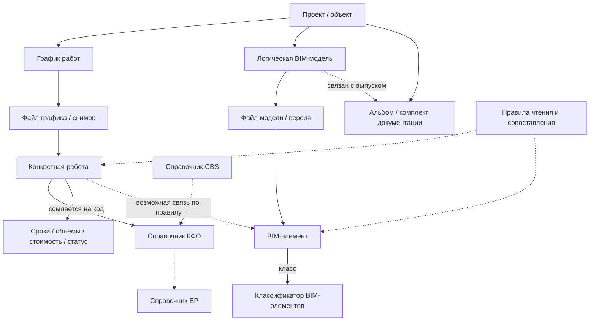

# SB_CDE — Мониторинг строительных работ (4D/5D)
## Стартовый каталог сущностей, артефактов, атрибутов и связей

> **Назначение.** Опорный контекст для дальнейшей проработки функций «Мониторинга строительных работ», в том числе связей между графиками, BIM-моделями, документацией и системными классификаторами. Это **не техническая схема БД**, не утверждённое ТЗ и не перечень уже реализованной функциональности.
>
> **Статусы утверждений:** **[ЗАФИКСИРОВАНО]** — непосредственно указано в постановке задачи; **[ПОДТВЕРЖДЕНО ИСТОЧНИКОМ]** — видно в приложенных документах; **[ПРЕДЛОЖЕНИЕ]** — рабочая классификация для обсуждения; **[ОТКРЫТЫЙ ВОПРОС]** — решение не принято. Пометка относится к отдельному утверждению, а не ко всему разделу.
>
> **Исторический статус.** Документ сохраняется как исходный снимок v0.1. Более поздние решения о названии модуля, XML-импорте и базовых/операционных версиях зафиксированы в корневом `SB_CDE_v0.2.md`; противоречащие ему открытые вопросы v0.1 не являются текущими решениями.

## 1. Главный принцип: не смешивать уровни

[ПРЕДЛОЖЕНИЕ] Для описания предметной области разделить объекты на **шесть уровней**.

| Уровень | Что описывает | Примеры |
|---|---|---|
| **1. Контекст проекта** | Где и в каком разрезе существуют данные | Проект, объект/корпус, стадия ПД/РД, раздел АР/КР, секция, этаж |
| **2. Логические информационные артефакты** | Объект учёта независимо от конкретного файла | График выполнения работ, BIM-модель, комплект/альбом документации |
| **3. Файлы и версии** | Конкретные носители и их состояния | `.sprj`, `.ifc`, `.rvt`, `.pdf`, версии загруженных файлов |
| **4. Справочники и правила** | Общие определения и способы интерпретации информации | CBS, КФО, ЕР, справочник работ, классы BIM-элементов, правила импорта и сопоставления |
| **5. Предметные сущности** | Что описывают данные внутри носителей | Конкретная работа графика, элемент BIM-модели |
| **6. Показатели и состояния** | Значения, изменяющиеся между планом, фактом, прогнозом и моментами времени | Даты, объёмы, стоимость, % выполнения, статус |

**Важно:** `работа в справочнике` ≠ `конкретная работа в графике` ≠ `BIM-элемент`; `BIM-модель` ≠ `файл модели` ≠ `версия файла модели`; `версия ПО Revit` ≠ `версия файла в СОД`.

## 2. Реестр сущностей: первая итерация

В колонке «Тип» дана **предлагаемая** принадлежность, а не факт реализации отдельной таблицы или сервиса.

| ID | Сущность / артефакт | Тип | Ключевые признаки | Основание / зрелость |
|---|---|---|---|---|
| `CTX_PROJECT` | Проект | Контекст | Идентификатор/шифр проекта | [ПРЕДЛОЖЕНИЕ] |
| `CTX_OBJECT` | Объект / корпус | Контекст | Шифр объекта; пространственная принадлежность | [ПОДТВЕРЖДЕНО ИСТОЧНИКОМ: EIR, п. 2.4] |
| `CTX_STAGE` | Стадия проекта | Контекст | ПД, РД | [ЗАФИКСИРОВАНО] |
| `CTX_DISCIPLINE` | Раздел проекта | Контекст | АР, КР и др. | [ЗАФИКСИРОВАНО] |
| `CTX_LOCATION` | Пространственная зона | Контекст | Корпус / секция / этаж / другая зона | [ЗАФИКСИРОВАНО для примеров] |
| `ART_SCHEDULE` | График выполнения работ | Логический артефакт | Проект, назначение графика, источник | [ЗАФИКСИРОВАНО]; название модуля не решено |
| `ART_MODEL` | BIM-модель | Логический артефакт | Стадия, раздел, дополнительные признаки деления | [ЗАФИКСИРОВАНО]; детали уточняются EIR/BEP |
| `ART_ALBUM` | Альбом / комплект документации | Логический артефакт | Стадия, шифр, раздел | [ЗАФИКСИРОВАНО] |
| `FILE` | Файл-источник | Физический артефакт | Формат, имя, расположение, принадлежность | [ЗАФИКСИРОВАНО] |
| `FILE_VERSION` | Версия файла | Физический артефакт | Идентификатор версии, дата, файл | [ЗАФИКСИРОВАНО для файлов BIM в системе]; для остальных уточнить |
| `REF_CBS` | Справочник CBS | Справочник | Код, наименование, единица измерения | [ПОДТВЕРЖДЕНО ИСТОЧНИКОМ: XLSX] |
| `REF_KFO` | Справочник КФО | Справочник | Код КФО, название, единица измерения | [ЗАФИКСИРОВАНО как системный справочник] |
| `REF_ER` | Справочник ЕР (единичных расценок) | Справочник | Код ЕР, наименование, единица, связь с КФО | [ПОДТВЕРЖДЕНО ИСТОЧНИКОМ: XLSX] |
| `REF_WORK` | Справочник работ | Справочник | Код работы, название, единица, связь с ЕР | [ПОДТВЕРЖДЕНО ИСТОЧНИКОМ: XLSX]; полнота не подтверждена |
| `REF_BIM_CLASS` | Классификатор элементов BIM-модели | Справочник | Код класса, название, группа | [ЗАФИКСИРОВАНО как системный классификатор; также EIR] |
| `RULE_IMPORT` | Правило чтения и преобразования источника | Правило | Формат, структура, распознавание колонок/атрибутов | [ПРЕДЛОЖЕНИЕ] |
| `RULE_MAPPING` | Правило сопоставления сущностей | Правило | Из какого поля/кода в какую сущность/связь | [ЗАФИКСИРОВАНО как потребность; модель правила предлагается] |
| `WORK_INSTANCE` | Конкретная работа графика | Предметная сущность | ID в графике, код КФО, название, локация, показатели | [ЗАФИКСИРОВАНО] |
| `BIM_ELEMENT` | Экземпляр элемента BIM-модели | Предметная сущность | ID элемента, код класса, код КФО при наличии, количественные параметры | [ЗАФИКСИРОВАНО] |
| `WORK_ELEMENT_LINK` | Связь работы с элементами | Связь | Работа, набор элементов, правило и основание | [ПРЕДЛОЖЕНИЕ]; кардинальность не утверждена |
| `METRIC_VALUE` | Значение показателя работы | Данные | Показатель, план/факт/прогноз, значение, дата/версия источника | [ПРЕДЛОЖЕНИЕ] |
| `WORK_STATUS` | Статус работы | Состояние | Статус и контекст определения | [ЗАФИКСИРОВАНО], способ получения открыт |

## 3. Логические артефакты и их файлы

### 3.1. График выполнения работ (`ART_SCHEDULE`)

**[ЗАФИКСИРОВАНО]** График является самостоятельным источником данных о работах и может относиться к будущему модулю «Планирование» или «КСП». На текущем этапе исходная форма — **локальные файлы**, основной названный формат — **Spider Project `.sprj`**. Возможные `.mpp` и `.xlsx` пока являются предположением, а не подтверждёнными поддерживаемыми форматами.

[ПРЕДЛОЖЕНИЕ] Разделять:

- **График** — логический объект («график строительства объекта X»).
- **Файл графика** — конкретный `.sprj` / иной источник.
- **Редакция/снимок графика** — конкретное состояние данных, полученное из определённого файла в определённый момент. Наличие собственного версионирования графиков в системе **не подтверждено**.
- **Строка/операция графика** — исходная запись, которая может представлять работу, группу работ или веху. Не каждую строку автоматически считать `WORK_INSTANCE`.

**[ПОДТВЕРЖДЕНО ИСТОЧНИКОМ]** Приложенный `down_PL_CON_13.xml` — пример выгрузки графика с иерархией операций (`WBS`, `OutlineLevel`, `Summary`), идентификаторами (`UID`, `Spider_Code`), датами `Start`/`Finish`, `ActualStart`/`ActualFinish`, процентом `PercentComplete`, полями объёмов и стоимости (`SP_VolPlan`, `SP_PlanCost`, `ActualCost`) и дополнительными атрибутами «Код КФО» и «КФО». **Этот XML не доказывает поддержку загрузки XML в продукте.** Поля показаны в исходном файле, но не обязательно заполнены у каждой операции.

### 3.2. BIM-модель (`ART_MODEL`)

**[ЗАФИКСИРОВАНО]** В системе существует логическая BIM-модель — абстракция, идентифицируемая прежде всего стадией и разделом проекта; её содержимое представлено файлами (`.rvt`, `.ifc`) и версиями файлов.

**[ПОДТВЕРЖДЕНО ИСТОЧНИКОМ]** EIR уточняет, что структура отдельных моделей может учитывать разработчика, объект, стадию, раздел, подраздел, а при необходимости — этажи, деформационные швы, части здания и др. (пп. 2.2, 2.4). Поэтому **только сочетания «стадия + раздел» недостаточно для уникального ключа BIM-модели**.

[ПРЕДЛОЖЕНИЕ] На логическом уровне учитывать:

| Атрибут | Комментарий |
|---|---|
| `model_id` | Системный ID логической BIM-модели — требуется уточнить существующую реализацию |
| `project / object` | Проект и объект |
| `stage` | ПД или РД |
| `discipline` | Раздел (АР, КР и др.) |
| `developer` | Организация-разработчик — по EIR |
| `part` | Дополнительная часть / зона / захватка — при наличии |
| `file_versions[]` | Связанные файлы и их версии, включая различие RVT/IFC |

**Именование по EIR** (раздел 2.4):

```text
ШП_ШО_СП_ШР_РП_ВП_ЧЗ
```

Где `ШП` — шифр проекта; `ШО` — объект; `СП` — стадия; `ШР` — разработчик; `РП` — раздел; `ВП` — версия **ПО разработки**; `ЧЗ` — необязательное дополнительное деление. Обязательность/значения блоков определяются EIR и уточняются BEP. Поля разделяются `_`; используются заглавные буквы и единый алфавит.

Пример `PD_AR_R24.rvt` из обсуждения — **сокращённая иллюстрация**, а не полное подтверждённое имя по EIR. Суффикс `R24` означает версию Revit, **не** «24-ю версию файла в СОД». Также `.ifc` и `.rvt` потенциально описывают один логический набор проектных данных в разных представлениях; их точную связь ещё нужно проверить.

**[ОТКРЫТЫЙ ВОПРОС]** Что считается идентичностью BIM-модели в действующей системе: отдельная карточка модели, запись MDR, путь/файл или сочетание метаданных? Как связаны RVT и IFC между собой?

### 3.3. Альбом / комплект документации (`ART_ALBUM`)

**[ЗАФИКСИРОВАНО]** Основные признаки: стадия (ПД/РД), шифр, раздел. [ПРЕДЛОЖЕНИЕ] Отличать логический **комплект документации** от файлов, в которых он опубликован, и от версий этих файлов.

**[ПОДТВЕРЖДЕНО ИСТОЧНИКОМ]** EIR связывает BIM-модели и разделы/комплекты документации через MDR и описывает выпуск документации на основании BIM-модели (разделы 2.2 и 3). Но конкретное правило «один альбом = один PDF» **не установлено**.

**[ОТКРЫТЫЙ ВОПРОС]** Альбом и комплект — синонимы в СОД или разные сущности? Какова связь `модель ↔ альбом`: 1:1, 1:N либо другая?

### 3.4. Файл (`FILE`) и версия файла (`FILE_VERSION`)

[ПРЕДЛОЖЕНИЕ] Единая терминология для любого файлового источника:

| Уровень | Пример | Смысл |
|---|---|---|
| Логический объект | Модель АР / график строительства / комплект РД | «Что это» |
| Файл | `...AR_R24.rvt`, `...AR.ifc`, `*.sprj` | «В каком носителе существует» |
| Версия файла | Загрузка № N / системный ID версии | «Какое состояние носителя рассматриваем» |
| Извлечённые записи | Элементы модели, операции графика, строки Excel | «Какие предметные данные прочитаны» |

Для файлов вне СОД не следует автоматически приписывать механизмы версионности СОД. Повторная локальная выгрузка пока может рассматриваться как **новый снимок источника**, если позднее будет согласован такой подход.

## 4. Справочники, классификаторы и правила

### 4.1. Справочники работ и классификация

**[ПОДТВЕРЖДЕНО ИСТОЧНИКОМ]** В приложенном `Справочники_Работ.xlsx` присутствуют листы:

| Лист | Содержимое, видимое в файле | Важная граница |
|---|---|---|
| `Справочник CBS` | Код, название, единица; пометка «Уровень 3» | Группа классификации, не экземпляр работы |
| `Справочник КФО` | Код, статья КФО, единица; «Уровень 4» | Запись справочника КФО, не работа с датами |
| `Справочник ЕР` | Код ЕР «Уровень 5», наименование, единица, код/статья КФО, прочие поля | Более детальный классификационный уровень |
| `Справочник Работы` | Код ЕР, код и название работы, единица, коэффициент перевода в ЕР | В файле видна **примерная запись**; полнота справочника не установлена |
| `DATA` | КФО, раздел, BIM, код и название класса BIM-элемента | Рабочая таблица сопоставления/признаков; не считать утверждённой автоматикой |
| `Классификатор BIM элементов` | Группа, код, название класса | Классификация BIM-элементов |

**[ЗАФИКСИРОВАНО]** КФО — редактируемый в системе справочник с административным ограничением доступа. **[ОТКРЫТЫЙ ВОПРОС]** Существуют ли CBS, ЕР и «Справочник Работы» как системные сущности или пока только в Excel? Наличие листа не доказывает наличие соответствующего модуля.

[ПРЕДЛОЖЕНИЕ] Зафиксировать цепочку классификаторов **для последующей проверки**, не навязывая её как единственно допустимую структуру всех графиков:

```text
CBS (уровень 3)
  └─ КФО (уровень 4)
       └─ ЕР (уровень 5)
            └─ Справочная работа (если используется)
```

Пример из XLSX: КФО `204.03.02.01` — «Устройство перегородок из гипсокартона»; с ним связаны несколько более детальных записей ЕР. Это **справочные** позиции. Конкретная операция графика на этаже/в секции — другой объект, даже если код КФО совпадает.

### 4.2. Классификатор BIM-элементов (`REF_BIM_CLASS`)

**[ЗАФИКСИРОВАНО]** Существует в системе как классификатор кодов и наименований элементов. **[ПОДТВЕРЖДЕНО ИСТОЧНИКОМ]** EIR, Приложение 2, содержит группы и коды, например `АС.04` — ненесущие стены и перегородки из каркасных материалов; `КР.03` — несущие стены. EIR п. 2.1.4 требует присвоения элементам кода по классификатору элементов BIM-модели.

**Не путать два поля:**

- **Код класса BIM-элемента** (`АС.04`, `КР.03`): что за тип объекта.
- **Код КФО** (`204.03.02.01` и т. п.): к какой классифицированной строительной работе/группе работ можно привязать объект.

**[ОТКРЫТЫЙ ВОПРОС]** Требование передавать в каждой BIM-модели именно **код КФО** не подтверждено данным шаблоном EIR: он явно содержит «Код по классификатору» **элементов**. Наличие/наименование/обязательность отдельного параметра КФО в RVT/IFC следует установить отдельно.

### 4.3. Правила (`RULE_IMPORT` и `RULE_MAPPING`)

**[ЗАФИКСИРОВАНО]** Нужен механизм, позволяющий связывать классы/атрибуты модели со значениями системных справочников. Также требуется рассмотреть будущую загрузку и разбор Excel в модуле «КСП».

[ПРЕДЛОЖЕНИЕ] Пока различать две функциональные группы правил:

| Группа | Назначение | Пример (гипотетический, **не реализован**) |
|---|---|---|
| **Извлечение и нормализация** | Прочитать исходное поле из IFC/RVT, XLSX или другого формата и привести к системному атрибуту | Колонка Excel `Дата начала` → `start_plan`; поле модели `Код по классификатору` → `bim_class_code` |
| **Сопоставление и формирование связи** | Выявить связь между записями разных доменов на основе кодов и дополнительных условий | `work.kfo_code = element.kfo_code` вместе с совпадением корпуса/секции/этажа |

Не смешивать **правило распознавания колонок Excel** и **правило связывания работ с BIM-элементами**: у них разные входы и результаты. Более тонкая разбивка (валидация, агрегирование, вычисление показателей) может быть добавлена позже после проработки реальных сценариев.

## 5. Предметные сущности минимального уровня

### 5.1. Конкретная работа (`WORK_INSTANCE`)

**Определение [ПРЕДЛОЖЕНИЕ].** Операция/работа в определённом графике, относящаяся к конкретному строительному объекту и, при наличии, конкретной части объекта. Она может ссылаться на КФО, но не является самой записью справочника КФО.

**[ЗАФИКСИРОВАНО]** Одна позиция КФО может детализироваться в графике по корпусам, секциям, этажам. Поэтому несколько работ могут ссылаться на **один** код КФО.

| Группа атрибутов | Поля на обсуждение | Статус |
|---|---|---|
| Идентификация | ID операции в источнике, ID графика, название, код КФО | [ЗАФИКСИРОВАНО в общем виде]; способы ID уточнить |
| Пространство | Проект, объект/корпус, секция, этаж | [ЗАФИКСИРОВАНО как возможная детализация] |
| Классификация | КФО, возможно CBS/ЕР/справочная работа | [ПРЕДЛОЖЕНИЕ]; наличие ЕР у каждой работы не подтверждено |
| Сроки | План: начало/конец; факт: начало/конец; прогноз: начало/конец | [ЗАФИКСИРОВАНО как целевые группы данных] |
| Объёмы | Плановый, фактический, прогнозный объём и единица измерения | [ЗАФИКСИРОВАНО] |
| Стоимость | Плановая, фактическая, прогнозная стоимость, валюта | [ЗАФИКСИРОВАНО] |
| Состояние | Статус; при наличии — % выполнения | [ЗАФИКСИРОВАНО для статуса]; % есть в примере XML |
| Происхождение | Из какого файла/снимка/операции получены данные | [ПРЕДЛОЖЕНИЕ] |

**[ОТКРЫТЫЙ ВОПРОС]** Источник показателей может различаться: даты — в графике, объёмы — вручную в графике, деньги — из графика или иных документов. Нельзя заранее объявлять один файл источником **всех** атрибутов работы.

### 5.2. Экземпляр BIM-элемента (`BIM_ELEMENT`)

**Определение [ПРЕДЛОЖЕНИЕ].** Конкретный экземпляр в определённом состоянии BIM-модели: например, отдельная стена, а не весь класс «Стены».

| Атрибут | Комментарий |
|---|---|
| `element_source_id` | ID/GlobalId/иной исходный идентификатор — уточнить по формату и API |
| `model_file_version_id` | Какую **версию файла** прочитали |
| `bim_class_code` | Код класса элемента BIM |
| `kfo_code` | Код КФО **если действительно присутствует или однозначно сопоставлен** |
| `location` | Объект, корпус/секция/этаж или другие пространственные признаки, если доступны |
| `quantities[]` | Физические показатели элемента с единицами: длина, площадь, объём, количество и т. п. |
| `attributes[]` | Прочие параметры BIM-элемента |

**[ЗАФИКСИРОВАНО]** У элемента есть собственное количественное значение, тогда как объём в графике может вводиться вручную, без расчёта по модели. Поэтому `объём графика` и `объём BIM-элементов` — **разные значения**, даже если оба имеют одинаковую единицу измерения. Не подменять одно другим автоматически.

**[ПОДТВЕРЖДЕНО ИСТОЧНИКОМ]** EIR предусматривает различающиеся по классам параметры (LOIN), включая длину, площадь и объём. Следовательно, не у каждого элемента обязательно есть единственный подходящий показатель с названием «Объём».

**[ОТКРЫТЫЙ ВОПРОС]** Каким идентификатором связывать «тот же элемент» между версиями файла? Стабильность идентификаторов при переэкспорте IFC не считается доказанной.

### 5.3. Связь работы и элемента (`WORK_ELEMENT_LINK`)

**[ПРЕДЛОЖЕНИЕ]** Это **отдельное отношение**, а не свойство только работы или только элемента. Примерный критерий: совпадение КФО **плюс** необходимых пространственных признаков. Условия, исключения и приоритеты будут предметом отдельной задачи.

Потенциально одна работа объединяет **несколько** элементов; вопрос, может ли один элемент участвовать **в нескольких** работах (например, разные технологические операции над одной стеной), **не решён**. Поэтому кардинальность `1:N` или `M:N` пока **не фиксировать**.

## 6. Сроки, объёмы, стоимость, статус

[ЗАФИКСИРОВАНО] Для работы рассматриваются три группы числовых/временных показателей — **сроки, объёмы, стоимость** — в трёх представлениях: **план / факт / прогноз**. Кроме того, имеется **статус работы**.

[ПРЕДЛОЖЕНИЕ] На уровне словаря разделить «тип показателя» и «сценарий его значения»:

| Показатель | План | Факт | Прогноз |
|---|---|---|---|
| Начало | `start_plan` | `start_actual` | `start_forecast` |
| Окончание | `finish_plan` | `finish_actual` | `finish_forecast` |
| Количественный объём | `quantity_plan` | `quantity_actual` | `quantity_forecast` |
| Стоимость | `cost_plan` | `cost_actual` | `cost_forecast` |
| Статус | — | **отдельная сущность/правило** | — |

Имена полей выше — **условный словарь для обсуждения**, а не утверждённая API-схема. Обязательно учитывать единицу измерения количества и валюту стоимости.

**Сохраняем принципиальные различия:**

1. **План** может означать утверждённый базис или текущий оперативный план — в постановке это ещё не определено.
2. **Факт** — сообщённое источником фактическое значение; не считать вычисленным из плана.
3. **Прогноз** — отдельное значение/оценка; нельзя считать его «фактом будущего».
4. **Статус** может приходить из файла либо вычисляться по правилам. Точный набор статусов и логика расчёта здесь **не утверждаются**.
5. **Отчётная дата** и дата получения/сохранения файла — разные понятия.
6. Если позже потребуется исторический 4D, нужно отдельно согласовать, сохраняются ли прошлые состояния графиков и моделей. Из наличия версии файла **не следует** наличие надёжной истории факта за каждую дату.

## 7. Источник истины и происхождение данных

**[ЗАФИКСИРОВАНО как принцип из постановки]** Один низкоуровневый артефакт желательно связывать с определённым источником, даже если сведения о нём представлены в нескольких местах.

**[ПРЕДЛОЖЕНИЕ]** Для избежания конфликтов уточнить правило: **источник истины назначается для конкретного атрибута/значения и его контекста**, а не обязательно один источник на всю бизнес-сущность «Работа».

| Данные | Потенциальный первичный источник | Что нельзя заключать заранее |
|---|---|---|
| Код/название КФО | Системный справочник КФО | Название из графика всегда идентично справочнику |
| Конкретная работа и её сроки | Файл/снимок графика | Все даты в системе всегда актуальны |
| Объём работы | График / иной будущий источник | Объём рассчитан из BIM |
| Стоимость работы | График / иной будущий источник | Стоимость есть для каждой работы |
| Геометрия и атрибуты элемента | Определённая версия RVT/IFC | Экспорт IFC побитово и семантически идентичен RVT |
| Код класса | Классификатор BIM-элементов + атрибут элемента | Код класса равен КФО |
| Связь работа ↔ BIM-элемент | Правило сопоставления + исходные атрибуты | Достаточно одного кода КФО без учёта локации |

[ПРЕДЛОЖЕНИЕ] При дальнейшем моделировании хранить для каждого извлечённого значения или связи минимум:

```text
source_artifact_id   — логический источник
source_file_id       — файл, если применимо
source_version_id    — версия файла или идентификатор снимка, если применимо
source_record_id     — исходная строка/операция/элемент
source_field         — исходное поле/параметр
observation_date     — дата, на которую относится значение (если известна)
extracted_at         — время извлечения данных (если фиксируется)
rule_id              — правило преобразования или сопоставления (если применялось)
```

**Это предложение для трассируемости, не требование к схеме БД.**

## 8. Черновая карта связей (только концептуально)



**Читать как карту понятий, не как ER-диаграмму:** сплошные связи здесь не означают утверждённые ограничения БД; пунктирные обозначают справочные или требующие проверки отношения. Связь между KFO и ER подтверждается примером XLSX; связь CBS и KFO по конкретным внешним ключам ещё следует проверить.

## 9. Пример, показывающий различие сущностей

> **[Условный пример, не запись из производственных данных]**
>
> КФО: `204.03.02.01` — «Устройство перегородок из гипсокартона» (код и название присутствуют в XLSX).
>
> Работа А в графике: указанный КФО + корпус 1 + секция 2 + этаж 3 + собственные сроки/объём/стоимость.
>
> Работа Б в графике: тот же КФО + корпус 1 + секция 2 + этаж 4 + **другие** сроки/объём/стоимость.
>
> BIM-элемент X: отдельная перегородка с собственным ID, кодом класса `АС.04` (класс присутствует в EIR), параметрами площади/геометрии и, возможно, кодом КФО.
>
> Правило связи: если есть нужные атрибуты, отнести X к работе А или Б по КФО **и пространственной принадлежности**. Конкретный алгоритм не задан.

Итог: **один КФО → несколько работ в графике → наборы BIM-элементов по правилам; физический объём BIM ≠ автоматически плановый объём работы**.

## 10. Вопросы, которые пока нельзя закрывать без решения

| № | Вопрос | Почему влияет на модель |
|---|---|---|
| `Q01` | «Планирование» и «КСП» — один логический тип графика или разные домены? | Границы модулей и источников |
| `Q02` | Есть ли системные версии графика или только локальные выгрузки? | История и сопоставление факта по датам |
| `Q03` | Какая сущность определяет идентичность логической BIM-модели в СОД? | Связь файлов RVT/IFC, альбомов и версий |
| `Q04` | Какие параметры КФО и локации реально есть в RVT и IFC? | Автоматическое сопоставление |
| `Q05` | Что служит стабильным ключом BIM-элемента между версиями? | История элементов |
| `Q06` | Из каких источников брать план/факт/прогноз сроков, объёмов и стоимости? | Источник истины по показателям |
| `Q07` | Статус импортируется или рассчитывается? Каковы его значения? | Состояния работ |
| `Q08` | Может ли один BIM-элемент относиться к нескольким работам? | Кардинальность связей |
| `Q09` | Что делать с работами КФО без представления в BIM? | Неполное BIM-покрытие — допустимый сценарий |
| `Q10` | Как разделить версию модели, версию графика и отчётную дату для истории 4D? | Корректное восстановление состояния |
| `Q11` | Какие типы Excel и структура колонок будут поддержаны модулем КСП? | Проектирование правил импорта |
| `Q12` | Системные CBS, ЕР и справочник работ существуют уже сейчас или только как XLSX? | Отличие системы от рабочего справочного файла |
| `Q13` | Что такое «альбом» в текущем продукте и сколько файлов может ему соответствовать? | Связи документации |

## 11. Правила использования этого файла в дальнейшей работе

[ПРЕДЛОЖЕНИЕ] Использовать этот документ как **словарь предметной области** для будущих задач 4D/5D.

1. Новые функциональности описывать с указанием IDs затронутых сущностей (`WORK_INSTANCE`, `BIM_ELEMENT`, `RULE_MAPPING` и т. д.).
2. Разделять **существующее в системе**, **факт из вложения**, **предлагаемую модель** и **открытый вопрос**. Не превращать предложение в факт автоматически.
3. Если появляется новая сущность, добавлять её в каталог **только после согласования**; до этого она существует в черновике конкретной задачи.
4. Если разрабатывается визуальная «карта» проекта, строить её **из зафиксированных сущностей и связей**, а не править изображение карты вручную. У каждой задачи может быть собственный черновик изменений карты; утверждение черновика — отдельное действие, не подразумевается автоматически.
5. При уточнении источника всегда называть формат и, где возможно, **конкретную версию файла/снимок**.
6. При обнаружении несовпадения значений в графике, модели и справочнике не выбирать «правильное» значение без согласованного правила приоритета.

## 12. Приложенные источники, использованные для первичной фиксации

1. **Постановка задачи от 08.10.2026** — исходные пользовательские определения графика, модели, альбома, КФО, классификаторов, правил, работ, элементов, сроков, объёмов, стоимости и статуса.
2. **`Приложение 6.1_Шаблон «Требования к обмену информацией (EIR)»(EIR +Приложения 1-5).docx`** — особенно разделы 2.2–2.4, 3, Приложение 1 (термины), Приложение 2 (классы BIM), Приложение 3 (LOIN). **Это шаблон EIR**, а не автоматически утверждённые требования любого объекта. В EIR, таблица 3.1-1, для 4D-сценария цифрового ПОС указана необходимость отдельного EIR — не считать текущий документ спецификацией 4D.
3. **`Справочники_Работ.xlsx`** — листы CBS, КФО, ЕР, Работы, DATA, Классификатор BIM элементов. Это пример структуры исходных справочных данных; не подтверждает самостоятельное наличие всех справочников в продукте.
4. **`down_PL_CON_13.xml`** — пример структуры операций графика и доступных полей; не означает наличие готового импорта XML в продукт.

---

**Текущее состояние каталога:** начальный черновик `v0.1`. **Не утверждено:** физическая схема хранения, алгоритмы 4D/5D, расчёт статусов, правила сопоставления, сценарии импорта, идентичность записей между версиями. Все эти решения принимаются в отдельных задачах и затем актуализируют каталог.
